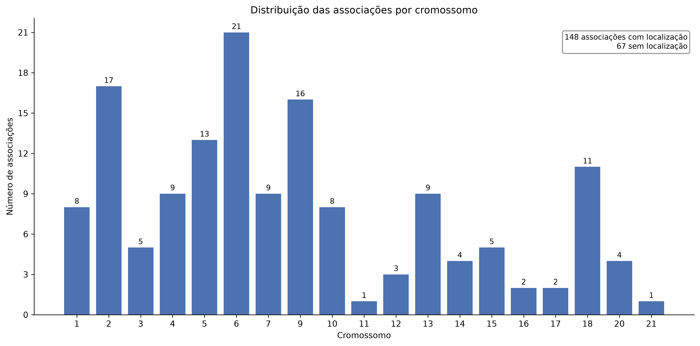
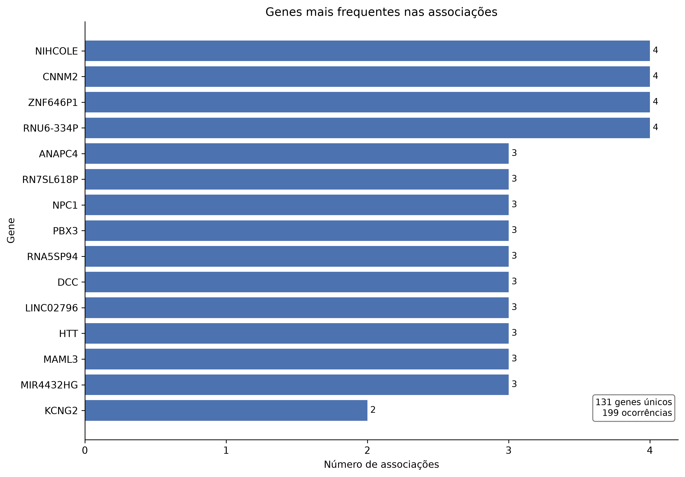
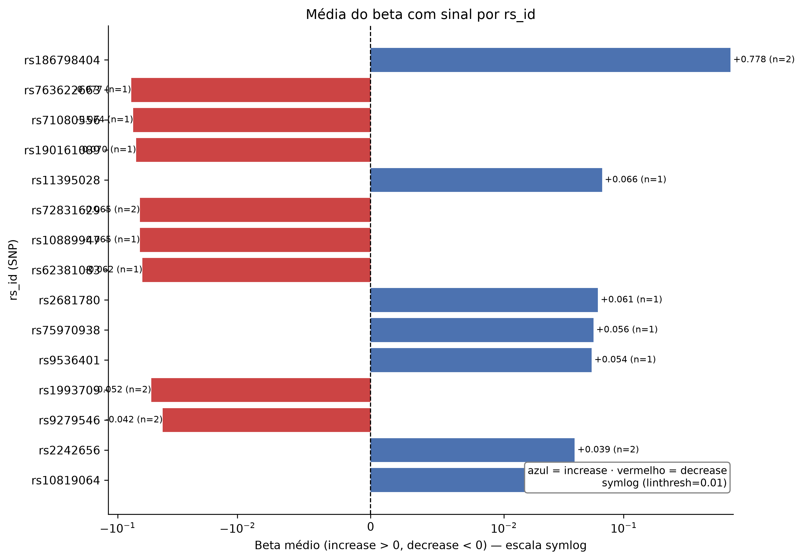
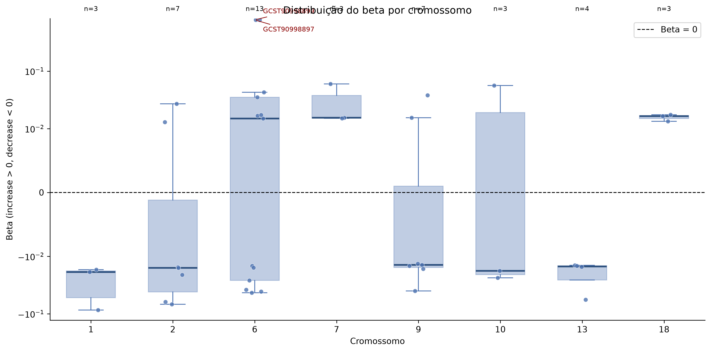

# Trabalho final — Associações genéticas da fibromialgia (GWAS Catalog)

**Programação e Análise de Dados em Saúde**

Docente: **Prof. Lucas Miguel de Carvalho**

Discentes: 
- **João Victor Rossetti Vieira** (RA 202630554)
- **Viviane Cristina Tavares Gallinucci Osorio** (RA 202652195) 


Análise exploratória das associações genéticas de **fibromialgia** (`MONDO_0005546`)
publicadas no [GWAS Catalog](https://www.ebi.ac.uk/gwas/efotraits/MONDO_0005546),
usando a API REST v2 como fonte de dados.

O script principal do projeto é o [`trabalho-final.py`](trabalho-final.py), que baixa
(quando habilitado), carrega, normaliza, limpa e visualiza os dados. A descrição
detalhada de cada campo devolvido pela API está em
[`dicionario_api_gwas.md`](dicionario_api_gwas.md).

## Arquivos do projeto

| Arquivo | Descrição |
|---|---|
| `trabalho-final.py` | Script principal: carga, normalização, limpeza e geração dos gráficos. |
| `data.json` | Resposta bruta da API do GWAS Catalog (215 associações). |
| `dicionario_api_gwas.md` | Dicionário de dados da API v2, com tipos, descrições e observações sobre valores ausentes. |
| `figuras/` | Gráficos gerados pelo script (PNG, 300 dpi). |
| `projeto-final.pdf` | Enunciado do trabalho. |
| `docs/` | Specs de desenvolvimento das etapas do projeto. |

## Requisitos

- Python 3.10 ou superior
- [`pandas`](https://pandas.pydata.org/)
- [`matplotlib`](https://matplotlib.org/)

As versões já validadas neste projeto são pandas 3.0.6 e matplotlib 3.11.2.

## Como executar — passo a passo

O script abre `data.json` e grava as figuras em `figuras/` por **caminhos
relativos**. Portanto, execute sempre os comandos a partir da raiz do projeto
(a pasta que contém `trabalho-final.py`, `data.json` e `requirements.txt`).

### Passo 1 — entre na raiz do projeto

```bash
cd ~/Fontes/trabalho_final_prog_bio
```

Confira se está no lugar certo (o comando deve listar `trabalho-final.py`):

```bash
ls trabalho-final.py data.json requirements.txt
```

### Passo 2 — escolha um ambiente Python com as bibliotecas instaladas

#### Opção A — usar o ambiente `aula` (já pronto nesta máquina)

É o caminho mais rápido: esse ambiente do pyenv já possui `pandas` e
`matplotlib`, então não é preciso instalar nada.

1. Teste o ambiente:

   ```bash
   PYENV_VERSION=aula pyenv exec python -c "import pandas, matplotlib; print('OK')"
   ```

   A saída deve ser `OK`. Se aparecer `ModuleNotFoundError`, use a Opção B.

2. Execute o script:

   ```bash
   PYENV_VERSION=aula pyenv exec python trabalho-final.py
   ```

   O mesmo efeito é obtido com o caminho direto do interpretador:

   ```bash
   ~/.pyenv/versions/aula/bin/python trabalho-final.py
   ```

   > Em um shell interativo com `pyenv-virtualenv` carregado, também vale
   > `pyenv activate aula` seguido de `python trabalho-final.py`. Se o
   > shell disser que `pyenv activate` não está disponível, prefira o comando
   > com `PYENV_VERSION` mostrado acima.

#### Opção B — recriar o ambiente `.venv` do projeto

O `.venv` atual está incompleto: não tem `pip`, `pandas` nem `matplotlib`.
Recrie-o usando um Python do pyenv (o `python3` do sistema não traz `pip`):

1. Crie (ou atualize) o ambiente virtual:

   ```bash
   PYENV_VERSION=3.13.15 pyenv exec python -m venv .venv
   ```

2. Ative o ambiente:

   ```bash
   source .venv/bin/activate
   ```

   O prompt passa a mostrar `(.venv)`. Para sair depois, use `deactivate`.

3. Instale as dependências do arquivo `requirements.txt`:

   ```bash
   python -m pip install -r requirements.txt
   ```

4. Execute o script (ainda com o `.venv` ativado):

   ```bash
   python trabalho-final.py
   ```

Em máquinas onde o `python3` já vem com `pip`, os passos 1 e 3 podem ser
escritos de forma genérica:

```bash
python3 -m venv .venv
source .venv/bin/activate
python -m pip install -r requirements.txt
```

### Passo 3 — acompanhe a saída e confira os resultados

Durante a execução o terminal mostra, nesta ordem:

1. as dimensões e as colunas do DataFrame (`(215, 30)`);
2. a amostra de linhas com betas numéricos;
3. o relatório da Etapa 2, com as colunas vazias/constantes removidas
   (de `(215, 30)` para `(215, 25)`);
4. a interpretação de cada um dos quatro gráficos da Etapa 3.

Ao final, confirme que os quatro PNGs foram gerados:

```bash
ls -lh figuras/
```

A execução foi bem-sucedida se aparecerem `01_cromossomos.png`,
`02_genes.png`, `03_beta_por_allele.png` e
`04_beta_boxplot_cromossomos.png`.

Para testar o agrupamento de betas por alelo (não depende de pandas nem de
matplotlib):

```bash
python3 -m unittest discover -v
```

### Problemas comuns

| Sintoma | Causa provável | Solução |
|---|---|---|
| `ModuleNotFoundError: No module named 'pandas'` | O interpretador usado não tem as bibliotecas | Use a Opção A ou instale com a Opção B |
| `No such file or directory: data.json` | O comando foi rodado fora da raiz do projeto | Volte ao Passo 1 (`cd ~/Fontes/trabalho_final_prog_bio`) |
| `pyenv: python: command not found` | Nenhuma versão definida para `pyenv exec` | Informe `PYENV_VERSION=aula` (ou `3.13.15`) antes do comando |
| `pyenv activate' requires Pyenv and Pyenv-Virtualenv...` | O shell não carregou o pyenv-virtualenv | Use `PYENV_VERSION=aula pyenv exec python trabalho-final.py` |
| `No module named pip` ao criar o `.venv` | O `python3` do sistema não traz `pip` | Crie o venv com `PYENV_VERSION=3.13.15 pyenv exec python -m venv .venv` |

### Download dos dados

O bloco de download via API está comentado no início do arquivo (linhas 24–27)
para não sobrecarregar o serviço. Para baixar novamente o `data.json`, basta
descomentar o trecho:

```python
with urllib.request.urlopen(
    "https://www.ebi.ac.uk/gwas/rest/api/v2/associations?size=300&efo_id=MONDO_0005546"
) as url:
    data = json.loads(url.read().decode())
    with open("data.json", "w", encoding="utf-8") as f:
        json.dump(data, f, ensure_ascii=False, indent=4)
```

## O que o script faz

O código é organizado em três etapas sequenciais, executadas em `__main__`.

### Etapa 1 — Carga e normalização (`etapa_1`)

1. Lê `data.json` com `json.load`.
2. Converte a lista `_embedded.associations` em um DataFrame com
   `pd.json_normalize`.
3. Cria três colunas derivadas para facilitar a análise:
   - `_mapped_genes` — genes mapeados unidos em uma única string separada por vírgulas;
   - `_allele` — `effect_allele` do primeiro item da lista `snp_allele` (a letra do alelo, não o `rs_id`);
   - `_cromossome` — cromossomo extraído de `locations` no formato `cromossomo:posição`.
4. Imprime as dimensões e os nomes das colunas do DataFrame.

### Etapa 2 — Remoção de colunas sem variação (`etapa_2`)

1. Identifica colunas **completamente vazias** e colunas **constantes** com
   `identificar_colunas_sem_variancia`.
2. Trata como ausentes: `NaN`, `None`, string vazia, apenas espaços, `"-"`, `"NR"`,
   listas/dicionários vazios.
3. Exibe um relatório com as colunas encontradas e um exemplo de valor de cada uma.
4. Retorna uma **cópia** do DataFrame sem essas colunas, sem alterar o original.

A remoção é necessária porque a base é composta por associações genéticas já
publicadas: não é possível inferir os valores ausentes sem inventar informação.

### Etapa 3 — Visualização e interpretação (`etapa_3`)

Gera quatro gráficos e imprime uma interpretação curta de cada um:

| Função | Figura gerada | Pergunta |
|---|---|---|
| `grafico_cromossomos` | `figuras/01_cromossomos.png` | Como as associações se distribuem entre os cromossomos? |
| `grafico_genes` | `figuras/02_genes.png` | Quais genes aparecem com mais frequência nas associações? |
| `grafico_beta_allele` | `figuras/03_beta_por_allele.png` | Qual é a média do beta com sinal para cada rs_id? |
| `grafico_beta_boxplot_cromossomo` | `figuras/04_beta_boxplot_cromossomos.png` | Como o beta se distribui em cada cromossomo e onde estão os outliers? |

Funções auxiliares usadas nessa etapa:

- `_salvar_grafico(fig, nome_arquivo)` — cria `figuras/` se necessário, salva em
  300 dpi e fecha a figura;
- `_ordenar_cromossomos(cromossomos)` — ordena `1`–`22`, `X`, `Y`, `MT` e deixa
  valores inesperados no final;
- `_beta_com_sinal(valor)` — converte textos como `"0.06 unit increase"` em
  `0.06` e `"0.06 unit decrease"` em `-0.06`;
- `rs_id_de_snp_allele(valores)` (em `analise_beta.py`) — extrai o `rs_id` do
  primeiro item de `snp_allele`;
- `resumo_beta_por_rsid(pares)` (em `analise_beta.py`) — recebe pares
  `(snp_allele, beta)`, agrupa pelo `rs_id` e devolve `(rs_id, média, n)`
  ordenado por `|média|`, ignorando SNPs e betas ausentes;
- `_valor_ausente` e `_valor_canonico` — normalizam a detecção e a comparação de
  valores ausentes e de listas/dicionários.

Os gráficos de beta usam apenas as associações cujo campo `beta` está no formato
textual com número, direção (`increase`/`decrease`) e unidade. Os demais valores
(por exemplo, `"-"` ou `"NR"`) são descartados dessas figuras. O gráfico 03
usa o `rs_id` extraído de `snp_allele` e escala `symlog` para acomodar betas de
magnitudes muito diferentes; o boxplot por cromossomo (04) exibe apenas grupos
com `n >= 3` e também usa `symlog` para tornar visíveis os outliers sem
comprimir as caixas.

## Painel de funções

| Função | Entrada | Saída |
|---|---|---|
| `etapa_1()` | — | `DataFrame` normalizado. |
| `etapa_2(df)` | `DataFrame` da Etapa 1 | Cópia sem colunas vazias/constantes. |
| `etapa_3(df)` | `DataFrame` da Etapa 2 | Gera os quatro gráficos e imprime interpretações. |
| `identificar_colunas_sem_variancia(df)` | `DataFrame` | Tupla `(colunas_vazias, colunas_constantes)`. |
| `grafico_cromossomos(df)` | `DataFrame` | Salva `01_cromossomos.png`. |
| `grafico_genes(df)` | `DataFrame` | Salva `02_genes.png`. |
| `grafico_beta_allele(df, top_n=15)` | `DataFrame` | Salva `03_beta_por_allele.png`. |
| `grafico_beta_boxplot_cromossomo(df, min_n=3)` | `DataFrame` | Salva `04_beta_boxplot_cromossomos.png`. |

## Gráficos gerados e interpretação

Esta seção apresenta os gráficos produzidos pelo script, o motivo de cada
visualização e as informações que podem ser obtidas a partir delas.

### 1. Distribuição das associações por cromossomo (`01_cromossomos.png`)



**Por que usar este gráfico:** o gráfico de barras permite comparar diretamente
a contagem de associações entre categorias (cromossomos), evidenciando
concentrações e ausências de forma imediata.

**Informações que podemos obter:**
- Quais cromossomos concentram mais associações reportadas para fibromialgia.
- A distribuição geral das associações ao longo do genoma (1–22, X, Y, MT).
- Quantas associações possuem localização cromossômica informada e quantas não
  têm localização (`locations` ausente), o que ajuda a dimensionar a cobertura
  espacial dos dados.

### 2. Genes mais frequentes nas associações (`02_genes.png`)



**Por que usar este gráfico:** o gráfico de barras horizontais é adequado para
comparar muitos rótulos textuais (nomes de genes), facilitando a leitura dos
mais frequentes sem sobreposição de labels.

**Informações que podemos obter:**
- Quais genes aparecem com maior recorrência nas associações mapeadas.
- A diversidade de genes envolvidos (genes únicos versus total de ocorrências),
  considerando que uma associação pode mapear para mais de um gene.
- Possíveis genes/loci prioritários para investigação, lembrando que frequência
  de associação não implica causalidade nem relevância clínica isolada.

### 3. Média do beta por rs_id (`03_beta_por_allele.png`)



**Por que usar este gráfico:** as barras horizontais mostram a média do beta
com sinal para cada `rs_id` (o identificador do SNP em `snp_allele`), ordenada
pela magnitude da média. A cor distingue `increase` (azul) de `decrease`
(vermelho), e a escala `symlog` (`linthresh=0.01`) permite ver simultaneamente
efeitos pequenos e atípicos. Cada barra traz o valor e o número de associações
(`n`). O nome do arquivo mantém a convenção antiga (`allele`), mas o agrupamento
é por `rs_id`.

**Informações que podemos obter:**
- Quais SNPs concentram as maiores magnitudes médias de beta.
- A direção do efeito em relação ao alelo reportado (`increase` > 0,
  `decrease` < 0) — o sinal depende de qual alelo o estudo escolheu como
  *effect allele* e não indica, por si só, maior ou menor risco clínico.
- Quantas associações sustentam cada média (anotações `n`). No recorte atual
  há 63 `rs_id` distintos para 71 associações com beta parseável; a maioria
  aparece uma única vez, então essas médias são exploratórias.

### 4. Distribuição do beta por cromossomo (`04_beta_boxplot_cromossomos.png`)



**Por que usar este gráfico:** o boxplot expõe a distribuição completa do beta
em cada cromossomo (mediana, dispersão e amplitude), enquanto a sobreposição
dos pontos individuais com jitter torna visíveis todos os valores — algo que a
mediana isolada (gráfico 03) não mostra. A escala `symlog` (`linthresh=0.01`)
evita que outliers extremos comprimam as caixas, preservando a leitura dos
demais grupos.

**Informações que podemos obter:**
- A variabilidade e a dispersão dos betas dentro de cada cromossomo, e não
  apenas sua tendência central.
- A presença de outliers e valores atípicos; em particular, no cromossomo 6 há
  dois valores idênticos de `beta = 0.778` (acessos `GCST90998899` e
  `GCST90998897`) reportados em dois accessions distintos, que não devem ser
  interpretados como evidência independente.
- A distribuição real quando `n` é pequeno (os pontos individuais deixam isso
  explícito).
- Comparação honesta entre cromossomos com amostra suficiente: são exibidos
  apenas cromossomos com `n >= 3`, com indicação de quantos grupos/linhas foram
  excluídos por amostra insuficiente.

**Limitação específica desta visualização:** os betas são adimensionais
(dependem da unidade/escala de cada estudo) e, neste recorte, todos os betas
parseáveis provêm de uma única publicação; portanto, diferenças entre
cromossomos não devem ser interpretadas como comparações de magnitude clínica
direta.

## Referência dos dados: `dicionario_api_gwas.md`

O arquivo [`dicionario_api_gwas.md`](dicionario_api_gwas.md) documenta a
estrutura da resposta da API v2 do GWAS Catalog, incluindo:

- contexto do dataset (215 associações, 10 estudos, 3 publicações);
- tabela com todos os campos da API, tipo, descrição oficial e presença no `data.json`;
- subcampos de `_links`;
- observações importantes, como:
  - `"-"`, `"NR"`, `""` e `[]` são **códigos de ausência diferentes**;
  - a API devolve listas em `mapped_genes`, `locations`, `snp_allele`, entre outros;
  - `or_per_copy_num` é a versão numérica de `or_value`;
  - `beta` é texto e precisa ser convertido para número;
  - `ci_lower`/`ci_upper` são os limites numéricos do IC95%;
  - `association_id` é a chave única da associação.

Consulte esse dicionário antes de alterar o script ou de interpretar colunas
derivadas como `_mapped_genes`, `_allele` e `_cromossome`.

## Limitações

- Não há imputação de valores ausentes: colunas sem variação são removidas.
- A base contém apenas associações já reportadas/publicadas, em grande parte
  significativas em nível genômico, o que limita comparações de significância.
- OR e beta estão disponíveis apenas para parte das associações.
- A direção do efeito (OR < 1 ou beta negativo) depende do alelo reportado e
  **não** deve ser interpretada como proteção ou risco clínico.
- Os gráficos agregam estudos diferentes; o script não realiza uma meta-análise.

## Referências

- [GWAS Catalog — fibromialgia (MONDO_0005546)](https://www.ebi.ac.uk/gwas/efotraits/MONDO_0005546)
- [GWAS Catalog REST API v2 — documentação](https://www.ebi.ac.uk/gwas/rest/api/v2/docs)
- [GWAS Catalog REST API v2 — referência](https://www.ebi.ac.uk/gwas/rest/api/v2/docs/reference)
- [Especificação OpenAPI (YAML)](https://www.ebi.ac.uk/gwas/rest/api/v2/rest-api-doc.yaml)
- [Documentação dos cabeçalhos do TSV](https://www.ebi.ac.uk/gwas/docs/fileheaders)
- Dicionário de dados do projeto: [`dicionario_api_gwas.md`](dicionario_api_gwas.md)
- Enunciado do trabalho: [`projeto-final.pdf`](projeto-final.pdf)
